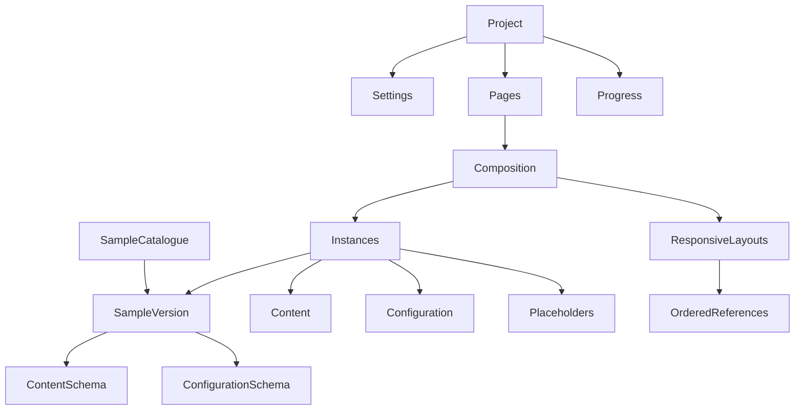

# Entity Relationships

Conceptually, Project owns settings, pages and progression. Each Page owns a Composition. Composition contains shared ComponentInstances and three ResponsiveLayouts. Each instance references a ComponentSample version and holds content, bounded configuration and placeholder records. Layouts reference shared instances. Progress records relate to the project and missions, not to the component hierarchy.

This is conceptual, not a relational schema. No database, indexes, migrations or storage keys are prescribed for MVP.
